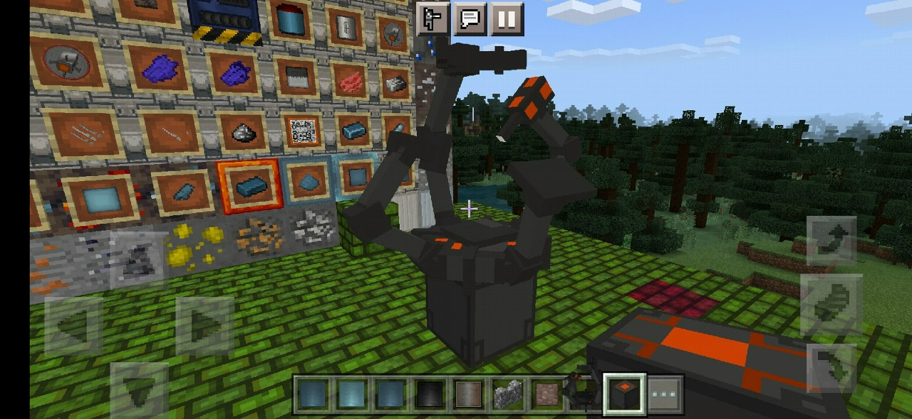
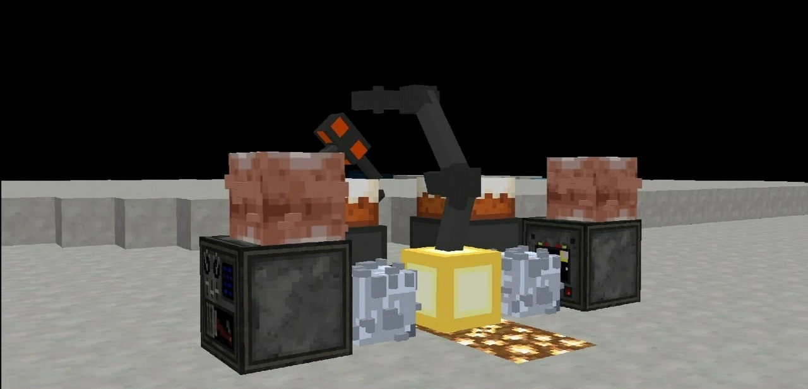
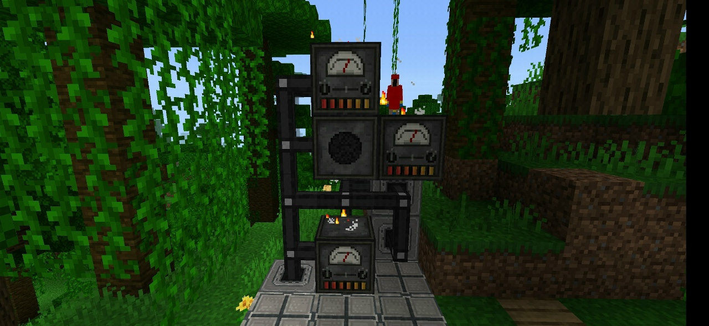

# С чего всё началось
Это было примерно в 7 классе, ближе к концу, в апреле. Мне было 13 лет, телефон у меня был второй год, или даже меньше.

Мне просто было скучно, и я вспомнил, как когда-то играл в inner core в давние времена, когда ещё не было хорайзона.

Я играл в **GalactiSpace** и **Infinity Forest**, и это было прекрасно, на моей памяти.

## Познакомился с reider__
Я решил узнать, что сейчас там да как, нашёл группы с модами, нашёл сборку SkyFactory с квестами от reider__, поиграл с кайфом, одноклассника подсадил :D

Потом связался с создателем сборки, предложил некоторые квесты.

Прошло некоторое время, я полистал посты в его группе, увидел **Galacticraft PE**. Спросил про то, когда выйдет обновление, что новостей давно нет, в итоге узнал что мод заброшен, но. Он предложил мне свои наработки (было не очень много в первой версии и немного побольше во второй: побольше механизмов), и с этого самого дня: десятого апреля двадцать второго года, началась моя карьера программистом с полного нуля без базовых знаний, без нейросетей, на js :D

Это было очень весело, я писал код на телефоне в редакторе, где была лишь подсветка синтаксиса, ловил постоянные ошибки от компилятора, не мог разобраться в функциях, объектах и аргументах, но за первые 4 месяца уже были несколько рабочих механизмов, кое-как их написал)

Иногда писал по 10 часов в день, это было всем хобби моей жизни и показало мне, в каком направлении я хочу двигаться дальше.

Но, к сожалению из-за малого опыта и написания в стиле "просто чтобы работало, разберусь попозже", когда настало "попозже" я понял, что нужно это переписывать почти полностью.

## Переписываю первый раз
Тогда у меня на моём стареньком пк на Pentium Dual Core E5800 добавилось ещё два гигабайта памяти - стало 4, и была установлена десятая винда, у меня наконец-то заработал вскод и я начал писать мод через тулчейн.

Эмулятор комп не тянул, про adb я не хотел разбираться, поэтому вручную упаковывал файлы после сборки и отправлял в беседу в вк, откуда распаковывал уже на телефоне, удаляя предыдущую распакованную версию, было весело и это позволило мне сохранить многие старые версии мода. Это было с 2023 по 2026 год примерно.

В данный момент у меня появился более новый компьютер, который тянет эмулятор, что облегчило разработку.

## Переписываю с нуля
В 2025 году я глянул на состояние кода проекта, и несмотря на классы и типизацию всё оставалось достаточно плохо, а большой объём кода (13к строк кода на одного программиста-самоучку) не позволял планомерно зарефакторить всё, что было написано за эти годы, в более приемлемый вид без огромных правок, и я честно пытался, но слишком устал.

Было принято тяжёлое решение: была написана мод-библиотека Fireflies чтобы отказаться от BlockEngine, на которую я ещё в то время пытался переносить мод. Кстати хорошая была идея, появилось достаточно крепкое апи для объектно-ориентированного подхода, которого нет в самом иннер коре.

И Galacticraft был начат с нуля: вся логика, всё апи.

Это была тяжёлая работа, но она была необходима. Спустя месяцы я практически догнал предыдущий прогресс, но теперь всё иначе: теперь я могу писать проект без той боли, которая возникала при просмотре легаси-кода.

